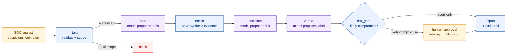

# Agentic SOC Triage — build and govern

A local, defensive AI agent that triages a synthetic suspicious-login alert end to end — validate scope,
gather evidence over MCP, correlate, reach a verdict, and pause for a human before any containment
recommendation can be recorded as actioned — paired with the security-architect layer that governs it.

The project is two halves of one idea: how you *build* an agent that touches a sensitive workflow, and how
you *govern* it.

```
engineering-core/   the agent: LangGraph runtime, MCP tools, deterministic guardrails, tests
governance/         the assurance layer: security manifest, control matrix, threat model, validator
```

## Architecture



## The control principle

> The model proposes; LangGraph controls state and routing; deterministic policy authorizes;
> MCP executes; a human approves anything consequential.

The model has no authority to act. Prompt injection is treated as something to *contain*, not something a
prompt can promise to prevent — so all authority lives in deterministic layers behind the model.

## What it demonstrates

- A production-shaped agent runtime (state, routing, durable checkpoints, human-in-the-loop) on
  self-hosted LangGraph, model-agnostic behind a swappable adapter (deterministic stub by default; Claude
  or a local model optional).
- Complete mediation of every tool call, MCP tool allow-listing with schema-pinning and drift detection,
  fail-closed human approval, a synthetic-only data scope, and a structured audit trail across the run.
- A governance layer that maps each control to OWASP LLM Top 10 (2025), MITRE ATLAS, and NIST AI RMF —
  and a validator that confirms the enforcement functions and tests the manifest names still exist in
  the code, so the governance can't silently drift from it.

## Results

- `engineering-core`: 6 control tests green; runs with no API key and no runtime network in the default profile; non-root
  container image; secret, SAST, and dependency scans run in CI (see `.github/workflows/security.yml`).
- `governance`: 24/24 checks pass — schema + 10 policy invariants + existence of the 7 enforcement
  functions and 6 guardrail tests the manifest names.

## Mutation check

Coverage shows which lines the tests ran. The mutation check shows which lines the tests
would notice if they were wrong. `scripts/mutation_check.py` applies 18 hand-written faults
to the guardrail code one at a time (for example "containment allowed for any verdict" or
"expired deadline ignored") and counts how many the suite catches. The original six control
tests catch 4; with `tests/test_attacks.py` the suite catches 15. The three that survive sit
behind an earlier check that already denies the same input, and the script lists them.

The faults are applied in a throwaway git worktree with its own interpreter, so the MCP tool
server subprocess is mutated along with the client and the checkout you run from is never
edited. Commit first: only committed code is measured.

```bash
python scripts/mutation_check.py --suite repo   # the six control tests
python scripts/mutation_check.py --suite all    # with the attack tests
```

## Quick start

```bash
cd engineering-core
python3.12 -m venv .venv && source .venv/bin/activate
python -m pip install '.[dev]'
pytest -vv
soc-triage --decision approve
```

Then the governance check:

```bash
cd ../governance
python3 -m pip install pyyaml jsonschema
python3 validate.py
```

See [`governance/`](governance/) for the security contract and framework mappings, and
[`engineering-core/`](engineering-core/) for the implementation.

## Author

Vasan Kidambi — [linkedin.com/in/vasankidambi](https://linkedin.com/in/vasankidambi)
