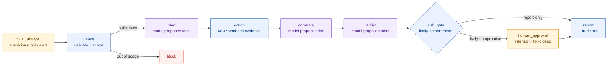

# Agentic SOC Triage: build and govern

A local AI agent that triages a synthetic suspicious-login alert and pauses for a human before any
containment recommendation is recorded, paired with a governance layer that checks the controls
against the code. It is a working, attackable reference for security engineers and architects.
It runs on a laptop on synthetic data, with no model key and no network at runtime.

## What this demonstrates

- The model proposes, deterministic policy authorizes: [`authorize_tool_call`](engineering-core/src/soc_triage_agent/guardrails.py) and the pinned schemas in [`mcp_client.py`](engineering-core/src/soc_triage_agent/mcp_client.py) mediate every tool call.
- Human approval fails closed: timeout, expired deadline or malformed response denies ([`validate_approval`](engineering-core/src/soc_triage_agent/guardrails.py), [`test_guardrails.py`](engineering-core/tests/test_guardrails.py)).
- Attack tests plus a mutation check: 75 tests, 3 strict xfails for open gaps ([#1](https://github.com/vasankidambi/soc-triage-agent/pull/1)); 21 hand-written faults, 18 caught ([#2](https://github.com/vasankidambi/soc-triage-agent/pull/2)).
- Strict evidence parsing: booleans, NaN, infinity and malformed timestamps count as missing evidence, never as scores ([#4](https://github.com/vasankidambi/soc-triage-agent/pull/4)).

## Quick start

About 2 minutes on a clean Python 3.12 environment (measured 111 seconds, 41 of them the install).

```bash
cd engineering-core
python3.12 -m venv .venv && source .venv/bin/activate
python -m pip install '.[dev]'
pytest -vv                      # 72 passed, 3 xfailed
soc-triage --decision approve   # pauses for approval, then prints the audit trace and report
cd ../governance && python3 -m pip install pyyaml jsonschema && python3 validate.py   # 24/24 checks passed
```

## Architecture



## The control principle

> The model proposes; LangGraph controls state and routing; deterministic policy authorizes;
> MCP executes; a human approves anything consequential.

The model has no authority to act. Prompt injection is treated as something to *contain*, not something a
prompt can promise to prevent, so all authority lives in deterministic layers behind the model.

The runtime is self-hosted LangGraph with durable checkpoints and a human-in-the-loop interrupt,
model-agnostic behind a swappable adapter (deterministic stub by default; Claude or a local model
optional). Tool calls go through an MCP broker that allow-lists tools, pins input schemas and
rejects drift. The governance layer maps each control to OWASP LLM Top 10 (2025), MITRE ATLAS and
NIST AI RMF, and `governance/validate.py` confirms the enforcement functions and tests the manifest
names still exist in the code (24 checks: 1 schema, 10 policy invariants, 7 functions, 6 tests).
Secret, SAST and dependency scans run in CI (`.github/workflows/security.yml`).

## Found and fixed

- [#1](https://github.com/vasankidambi/soc-triage-agent/pull/1) the six control tests proved the happy path only; an attack suite now states what each control must do under hostile input.
- [#2](https://github.com/vasankidambi/soc-triage-agent/pull/2) nothing measured whether the tests would notice a broken guardrail; a mutation check now applies 21 faults and lists the survivors.
- [#3](https://github.com/vasankidambi/soc-triage-agent/pull/3) a second run on the same thread id merged two audit trails, and a refused run could still overwrite the stored record; the guard now runs before LangGraph writes.
- [#4](https://github.com/vasankidambi/soc-triage-agent/pull/4) the default adapter returned 0.94 regardless of evidence; seven named rules now score parsed fields, and benign evidence stays benign.

Still open, as strict xfails: a changed tool description is not detected, and a model that says benign against high-risk evidence skips the human.

## How the default stub scores

The default adapter is a fixed rule set over structured evidence, so the demo runs with no
model and no key, and every verdict can be traced to the fields that produced it. Each tool
output is parsed once into a strict shape before any rule reads it: booleans are not numbers,
NaN and infinity are not scores, timestamps must carry a timezone and are compared in UTC, and
a source that does not parse counts as missing. Free text never moves the score. Each fact is
counted from one source. Missing tool output is never treated as benign.

| Rule | Evidence | Weight | Reference |
|---|---|---|---|
| R1 | `alert.failed_attempts` of 5 or more | 0.30 | ATT&CK T1110 Brute Force, DET0463 AN1279 "excessive login attempts followed by success" |
| R2 | `ip_reputation.risk_score` of 0.7 or more | 0.25 | Entra ID Protection "Malicious IP address", "Anonymous IP address" |
| R3 | `alert.device_id` not in `identity_lookup.managed_devices` | 0.15 | Entra ID Protection "Unfamiliar sign-in properties" |
| R4 | latest sign-in region differs from `identity_lookup.home_region` | 0.12 | Entra ID Protection "Atypical travel", "New country"; T1078 DET0560 |
| R5 | SIEM impossible-travel correlation present | 0.08 | Entra ID Protection "Impossible travel" |
| R6 | alert and latest sign-in disagree on device or address | 0.20 | evidence integrity; alone it is suspicious |
| R7 | a tool output is missing or unusable | floor 0.20 | missing evidence is not benign |

Score is the capped sum of fired weights. Labels: benign below 0.20, suspicious from 0.20,
likely-compromise from 0.60. Only likely-compromise reaches containment and human approval.
The sample alert scores 0.90 with R1 to R5 fired. No two rules reach 0.60. Three rules reach
it only as R1 and R2 with any third, R1 and R6 with R3 or R4, or R2, R6 and R3. Any four rules
that include R1 or R2 reach it.
The weights illustrate the mechanism on synthetic data; they are not a calibrated model.

## Mutation check

Coverage shows which lines the tests ran. The mutation check shows which lines the tests
would notice if they were wrong. `scripts/mutation_check.py` applies 21 hand-written faults
to the guardrail and stub code one at a time (for example "containment allowed for any verdict",
"expired deadline ignored" or "bool accepted as a number") and counts how many the suite catches.
The original six control tests catch 4; with `tests/test_attacks.py` the suite catches 18. The
three that survive sit behind an earlier check that already denies the same input, and the
script lists them.

The faults are applied in a throwaway git worktree with its own interpreter, so the MCP tool
server subprocess is mutated along with the client and the checkout you run from is never
edited. Commit first: only committed code is measured.

```bash
python scripts/mutation_check.py --suite repo   # the six control tests
python scripts/mutation_check.py --suite all    # with the attack tests
```

## Layout

```
engineering-core/   the agent: LangGraph runtime, MCP tools, deterministic guardrails, tests
governance/         the assurance layer: security manifest, control matrix, threat model, validator
```

See [`governance/`](governance/) for the security contract and framework mappings, and
[`engineering-core/`](engineering-core/) for the implementation.

## Author

Vasan Kidambi, [linkedin.com/in/vasankidambi](https://linkedin.com/in/vasankidambi)
