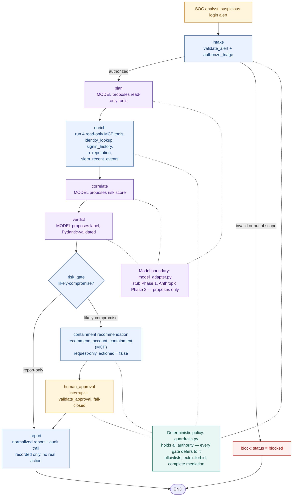

# Architecture

The defensive SOC triage flow — the model proposes, deterministic policy (`guardrails.py`)
authorizes, MCP tools execute over local stdio, and a human approves anything consequential.
The model holds no authority.

